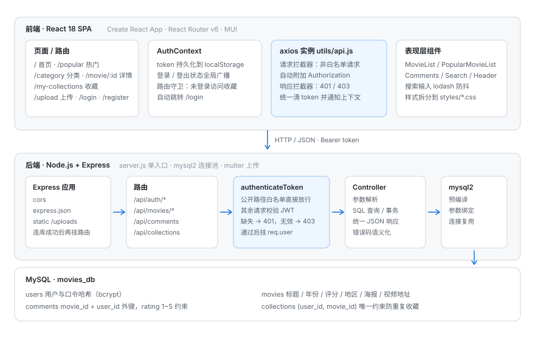

# 电影社区

前后端分离的电影社区平台：浏览与分页、按类型 / 地区 / 年代筛选、关键词搜索、电影详情与星级评论、收藏列表，以及基于 JWT 的用户体系。

前端是 React 18 单页应用，后端是 Express + MySQL 的 REST API。写它的重点是**把「无状态认证 + 前后端职责边界」这两个问题落到实处**：令牌怎么存、过期怎么处理、哪些接口必须带身份、哪些数据必须由服务端裁决。



## 功能

- **用户体系**：注册 / 登录，口令用 bcrypt 哈希；登录后签发 JWT，前端持久化并在请求中自动附带
- **电影列表**：分页（`page` / `limit`），返回总数与总页数
- **筛选**：按类型（`type`）、地区（`region`）、年代（`year`，支持「90年代」这类区间）组合查询
- **搜索**：标题模糊匹配，输入做防抖
- **详情页**：影片信息、简介、海报、相关影片
- **评论**：一句话点评或 1~5 星评分，可删除自己的评论
- **收藏**：加入 / 移除收藏，查询收藏状态与个人收藏列表

## 技术栈

| | 选型 |
|---|---|
| 前端 | React 18 · React Router v6 · MUI 5 · Axios · lodash（防抖） |
| 后端 | Node.js · Express 4 · mysql2 · jsonwebtoken · bcryptjs · multer |
| 数据库 | MySQL 8 |
| 配置 | dotenv（`backend/.env`，示例见 `backend/.env.example`） |

## 架构

```
React 页面组件
   │  只调用 utils/api.js 里的 axios 实例，不直接写 fetch
   ▼
axios 实例（请求拦截器附加 Bearer token，响应拦截器统一处理 401 / 403）
   │  HTTP + JSON
   ▼
Express（cors / express.json / 静态 /uploads）
   ▼
路由（/api/auth、/api/movies、/api/comments、/api/collections）
   ▼
authenticateToken（公开路径白名单放行，其余校验 JWT 并挂 req.user）
   ▼
Controller（参数校验、参数化 SQL、统一 JSON 响应）
   ▼
mysql2 → MySQL（users / movies / comments / collections）
```

关键约定：**身份只从令牌里取，不从请求体里取**。所有「这个人能操作哪些数据」的判断都用 `req.user.id`，避免客户端伪造 `user_id`。

## 快速开始

### 1. 建库

按顺序执行建表脚本（外键依赖前面的表）：

```bash
mysql -u root -p < backend/users.sql
mysql -u root -p < backend/movies.sql       # 含 8 部初始电影
mysql -u root -p < backend/comments.sql
mysql -u root -p < backend/collections.sql
```

### 2. 启动后端

```bash
cd backend
npm install
cp .env.example .env        # 修改 DB_PASSWORD / JWT_SECRET
npm start                   # http://localhost:5000
```

### 3. 启动前端

```bash
cd frontend
npm install
cp .env.example .env.local  # 可选，默认指向 http://localhost:5000/api
npm start                   # http://localhost:3000
```

## 环境变量

**backend/.env**

| 变量 | 默认值 | 说明 |
|---|---|---|
| `PORT` | 5000 | 服务端口 |
| `JWT_SECRET` | 开发占位值 | 签名密钥；`NODE_ENV=production` 时必须显式设置，否则启动即报错 |
| `JWT_EXPIRES_IN` | 7d | 令牌有效期 |
| `DB_HOST` / `DB_PORT` | localhost / 3306 | 数据库地址 |
| `DB_USER` / `DB_PASSWORD` / `DB_NAME` | root / 空 / movies_db | 数据库账号与库名 |
| `MAX_UPLOAD_SIZE` | 524288000 | 单文件上传上限（字节） |

**frontend/.env.local**

| 变量 | 默认值 | 说明 |
|---|---|---|
| `REACT_APP_API_BASE_URL` | http://localhost:5000/api | 后端 API 基址，上传文件地址也据此推导 |

## API

| 方法 | 路径 | 鉴权 | 说明 |
|---|---|---|---|
| POST | `/api/auth/register` | — | 注册，返回令牌 |
| POST | `/api/auth/login` | — | 登录，返回令牌与用户信息 |
| GET | `/api/auth/me` | 需要 | 当前登录用户 |
| GET | `/api/movies` | — | 分页列表（`page`、`limit`，默认 1 / 4） |
| GET | `/api/movies/search` | — | 筛选与搜索（`query`、`type`、`region`、`year`、`page`、`limit`） |
| GET | `/api/movies/popular` | — | 热度榜单：评分 50% + 加权评论数 30% + 收藏数 20%，归一化后取前 4 |
| GET | `/api/movies/:id` | — | 详情 |
| GET | `/api/movies/:movieId/comments` | — | 某部电影的评论（带用户名，按时间倒序） |
| POST | `/api/comments` | 需要 | 发表评论：`{ movie_id, content, rating }`，两者不可同时为空 |
| DELETE | `/api/comments/:id` | 需要 | 删除评论（仅本人） |
| POST | `/api/collections` | 需要 | 收藏：`{ movie_id }` |
| DELETE | `/api/collections/:movieId` | 需要 | 取消收藏 |
| GET | `/api/collections/status/:movieId` | 需要 | 是否已收藏 |
| GET | `/api/collections/:userId` | 需要 | 用户收藏列表 |

鉴权失败：未携带令牌返回 `401`，令牌无效 / 过期返回 `403`。

## 目录结构

```
movie-community-app/
├── frontend/                     # React SPA
│   ├── src/
│   │   ├── pages/               # Home / Popular / Category / MovieDetail / MyCollections / MovieUpload
│   │   ├── components/          # MovieList / Comments / Search / Header / Footer
│   │   ├── auth/                # AuthContext / Login / Register
│   │   ├── utils/               # api.js（axios 实例）、urlUtils.js（图片与视频地址）
│   │   └── styles/              # 分页面样式
│   └── public/img/              # 种子海报
├── backend/                      # Express API
│   ├── server.js                # 入口：中间件、multer、连库后挂路由
│   ├── src/
│   │   ├── config.js            # 环境变量统一读取与校验
│   │   ├── routes/              # authRoutes / movieRoutes
│   │   ├── controllers/         # authController / movieController
│   │   └── middleware/          # authenticateToken
│   ├── users.sql  movies.sql  comments.sql  collections.sql
│   └── uploads/                 # 上传文件（不入库）
└── docs/architecture.svg
```

## 设计取舍

**为什么用 JWT 而不是 Session**
前端是独立部署的 SPA，后端不渲染页面，也不需要「服务端主动踢人」。JWT 让后端保持无状态，横向扩容时不必共享会话存储。代价是无法主动失效，所以令牌有效期收敛到 7 天，并由前端在 401/403 时统一清理。

**为什么把 401/403 处理放在 axios 拦截器**
令牌过期是全局问题，如果每个请求各自 catch，必然出现「某个页面忘了处理」的漏网情况。拦截器把「失效 → 清 token → 通知上下文 → 跳登录」收敛到一处，页面组件只关心业务数据。

**为什么公开路径用白名单**
`authenticateToken` 采用默认拒绝策略：不在白名单里的路径一律校验令牌。这样新增受保护接口时不需要额外配置，忘记声明的后果是「多校验一次」，而不是「漏校验」。

**为什么收藏要加唯一约束**
`UNIQUE (user_id, movie_id)` 让「重复收藏」在数据库层就不可能发生，比在应用层先查后插更可靠（并发下也不会插重）。

## 安全实践

- 口令只存 bcrypt 哈希（cost 10），接口不回传任何口令字段
- 所有 SQL 使用 `?` 占位符 + 参数数组，杜绝字符串拼接注入
- 身份统一取自 `req.user.id`，不接受客户端传来的用户 ID
- 上传按字段分流到 images / videos 目录，`multer` 校验 MIME 前缀与大小上限，文件名随机化
- 密钥、数据库口令全部走环境变量；生产环境缺失 `JWT_SECRET` 直接拒绝启动

## 已知限制

- **影片上传**：前端上传页与后端 `multer` 配置已完成，`POST /api/movies/upload` 路由尚未接入，当前提交会返回 404
- 令牌无刷新机制，过期需重新登录；前端也未做路由级守卫（仅接口层拦截）
- 错误响应为 `{ error: string }`，未做统一错误码
- 未引入自动化测试；`*.sql` 需手工按顺序执行
- 上传目录未做清理策略，示例也未接入对象存储

## License

MIT
